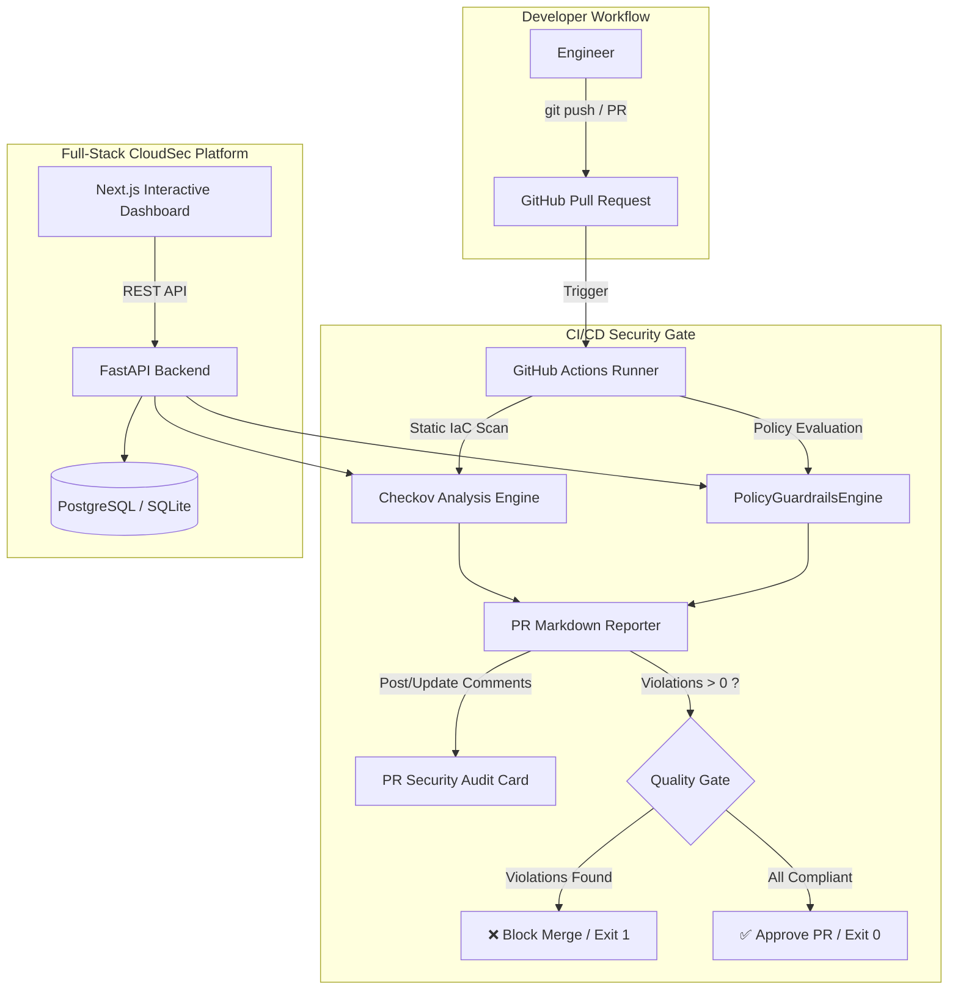

# 🛡️ CloudSecAI

> **Autonomous DevSecOps & Cloud Security Policy Engine** with static Infrastructure-as-Code (IaC) auditing, organizational guardrails enforcement, and automated CI/CD pull request security gates.

---

## 🏗️ Architecture Overview



---

## ✨ Key Capabilities

1. **Static IaC Security Scanning:**
   - Multi-framework Terraform scanning utilizing Checkov benchmarks.
   - Comprehensive rule evaluation against CIS Benchmarks, AWS best practices, and standard compliance frameworks.

2. **Enterprise Policy Guardrails Engine (`PolicyGuardrailsEngine`):**
   - **Tag Governance:** Strictly enforces organizational tagging rules (`Environment`, `Owner`).
   - **FinOps Compute Guardrail:** Intercepts and blocks high-cost GPU/compute instances (e.g., `p4d.24xlarge`).
   - **Secret Scanning:** Flags unencrypted secrets and hardcoded credentials in Terraform configurations.

3. **Automated CI/CD Security Gates:**
   - Evaluates incoming PRs before merge.
   - Posts detailed Markdown findings with contextual AI remediation recommendations.
   - Hard gate failure mechanism (`exit 1`) to prevent non-compliant infrastructure code from landing in `main`.

4. **Modern Decoupled Full-Stack Web Interface:**
   - **Backend:** FastAPI with Pydantic v2 validation models and resilient UUID auto-generation.
   - **Frontend:** Next.js dashboard for real-time audit triggers, findings breakdown, and remediation diff views.

---

## 🚀 Quickstart & Local Setup

### 1. Prerequisites
- Docker & Docker Compose
- Python 3.12+
- Node.js 18+

### 2. Run with Docker Compose
```bash
# Clone the repository
git clone https://github.com/Itznikhil028/cloudsec-ai.git
cd cloudsec-ai

# Start backend, database, and frontend containers
docker compose up --build
```
- **Frontend Dashboard:** `http://localhost:3000`
- **FastAPI OpenAPI Docs:** `http://localhost:8000/docs`

---

## 🧪 Testing the Security Engine

### Verify Policy Guardrails via API:
```bash
# Tag Policy Test
curl -s -X POST http://127.0.0.1:8000/api/v1/scans/submit   -H "Content-Type: application/json"   -d '{"project_name": "Audit", "raw_iac_code": "resource "aws_s3_bucket" "b" { bucket = "test" }"}'   | grep -o "ORG_POL_TAG_[A-Z]*"

# FinOps Guardrail Test
curl -s -X POST http://127.0.0.1:8000/api/v1/scans/submit   -H "Content-Type: application/json"   -d '{"project_name": "FinOps", "raw_iac_code": "resource "aws_instance" "i" { instance_type = "p4d.24xlarge" }"}'   | grep -o "ORG_POL_FINOPS_[0-9]*"
```

---

## 🔒 License
MIT License. Built for secure, autonomous cloud infrastructure management.
